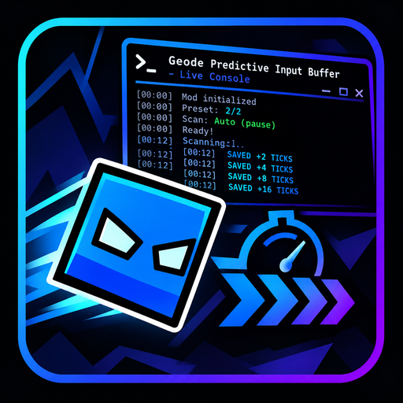

# Geode Predictive Input Buffer



A Geometry Dash 2.2081 / Geode mod fork that tests input timings against simulated player trajectories and delays eligible inputs when a later timing is predicted to be safer.

**Project status:** unreleased personal-testing fork. It is intended for development and controlled in-game testing, not as a guarantee that every collision can be avoided.

## What it does

- Simulates the player's trajectory and searches for a safer input window.
- Queues presses and releases in game time so their order and hold duration are preserved.
- Re-checks delayed inputs against the live player state.
- Offers five selectable profiles: Stage 1–4 and Off.
- Can scan supported levels while paused and save an experimental route.
- Uses a text-only Windows live console styled after `logo.png`: midnight-blue background, electric blue/cyan accents, violet section lines, timestamped colored events, and a compact scan progress bar. Saves and fired inputs appear alongside warnings and deaths; routine per-click debug traces stay in the in-game Log/Dev views and exported reports. The frame is drawn once when opened. Events are queued in a 96-line bounded buffer and drained at no more than two terminal lines per UI frame; warning/death lines take priority over routine saves/fires if the terminal falls behind. This keeps blocking terminal I/O out of the input hook. There are no image assets, animation timers, threads, polling loops, or per-frame console redraws.

## Controls

| Key | Action |
|---|---|
| `F6` | Cycle Stage 1 → Stage 2 → Stage 3 → Stage 4 → Off |
| `F7` | Close or reopen the Windows live console |
| `F9` | Cycle Experimental Micro-Cancel: OFF → 1T → 2T → 3T → OFF |

The stage limits are expressed in base physics ticks:

| Stage | Other modes | Wave |
|---|---:|---:|
| Stage 1 | 2 | 2 |
| Stage 2 | 4 | 4 |
| Stage 3 | 8 | 8 |
| Stage 4 | 16 | 8 |
| Off | Raw input | Raw input |

The current fork's console is Windows-only. The repository metadata contains other platform targets, but the automated Geode build currently produces and validates only a Windows package; other platforms should be considered unverified by this workflow.

## Experimental micro-cancel (test branch only)

**This feature is experimental and disabled at every program launch.** Press F9 to cycle exactly four states: OFF, one, two, or three base ticks. The selection is session-only and is never saved.

It only considers a fresh press when the normal predictor finds an immediate death with no safe delayed press, and only in Wave spam or a stable, near-horizontal Ship segment. Ship eligibility now needs four consecutive stable motion samples rather than eight, and the evidence is reset when a portal changes gamemode. The hidden Geometry Dash player simulator tests a single release at +1, +2, or +3 base ticks, then simulates the player's learned natural tap-and-gap cycle. The expected follow-up is checked at an early, nominal, and late timing; the nominal timing and at least one neighbour must survive with clearance. A candidate is rejected when the user's normal tap would end before the automatic release, the next manual tap would arrive too late, geometry is unknown, movers/orbs are involved, or the CPU budget is exhausted.

When approved, the mod sends exactly one key-up. It never auto-presses or repeats a tap. The simulated follow-up press and release are hypothetical checks only; the running mod does not send or schedule them. The user's real physical key-up is swallowed once after the synthetic release, and the real tap/gap timing is recorded at that physical key-up so automatic releases do not corrupt rhythm calibration. If the user releases before the scheduled tick, the intervention is cancelled. A missed tick is not executed late. F9 can turn the mode OFF and cancel a pending release.

The extra simulation budget remains capped at 900 microseconds per eligible attempt. Dual/two-player input and uncertain predictions remain excluded. Deterministic GD-inspired tests validate the scheduling policy, while runtime candidates are checked with the hidden in-game Geometry Dash player simulator. This remains experimental and must be tested in practice mode; passing CI is not proof of in-game reliability.

## Scanning and safety

Automatic scanning starts when a compatible level is paused and runs in short processing slices. The level must remain paused while the simulated scan runs.

A scan is advisory. Some level mechanics, object interactions, portal sequences, dual sections, moving objects, or unsupported states can make a simulated route incomplete or inaccurate. The scanner may recover past sections it cannot model, so a completed scan must not be interpreted as proof that every saved segment is valid.

**Use Scanned Route (Experimental)** is disabled by default. Keep it disabled while validating new changes, and test any route in practice mode before relying on it.

The input queue has a bounded capacity. If it reaches that limit, the mod now flushes accepted events in order and passes the current physical input directly to Geometry Dash rather than swallowing that transition. This is a safety fallback, not normal timing behavior.

## Build

The Windows Geode package is built by [GitHub Actions](https://github.com/JeremiFerreras/Input-buffer/actions). The workflow uses the Geode build action and the bindings revision pinned in `.github/workflows/build.yml`.

For a local Geode development environment with the SDK configured, use:

```sh
geode build
```

## Tests

The standalone core tests do not require Geometry Dash or the Geode SDK. From the repository root:

```sh
g++ -std=c++20 -O2 -I src tests/core_tests.cpp -o core_tests
./core_tests
g++ -std=c++20 -O2 -I src tests/micro_cancel_sim.cpp -o micro_cancel_sim
./micro_cancel_sim
python3 tests/verify_video_profile.py
python3 -m json.tool mod.json > /dev/null
```

The C++ suite exercises the scheduler, timing search, and other pure logic with synthetic inputs. It also runs 5,000 deterministic queue bursts and 10,000 deterministic monotonic delay-search windows. CI repeats the C++ suite with AddressSanitizer, UndefinedBehaviorSanitizer, and libstdc++ assertions. The Python suite also checks the text-only console theme and its event-driven, no-animation design. The Python suite checks project metadata, console-output policy, and important source/profile invariants. These tests do not emulate Geometry Dash physics or prove in-game prediction accuracy.

For live validation, follow [tests/IN_GAME_CHECKLIST.md](tests/IN_GAME_CHECKLIST.md) and record any discrepancy between the console output and the actual player behavior.

## Compatibility

- Game metadata target: Geometry Dash 2.2081.
- Geode metadata requirement: 5.11.2.
- CI package currently built: Windows.
- Console controls and messages: Windows only.

## Project files

- [Description](DESCRIPTION.md)
- [Changelog](changelog.md)
- [In-game checklist](tests/IN_GAME_CHECKLIST.md)
- [Build and test workflow](.github/workflows/build.yml)

## Credits

- Fork integration, profile, tests, and documentation: Jeremi Ferreras.
- The original Input Buffer simulation/input-scheduling code credits AlQuerez23 in its source comments.
